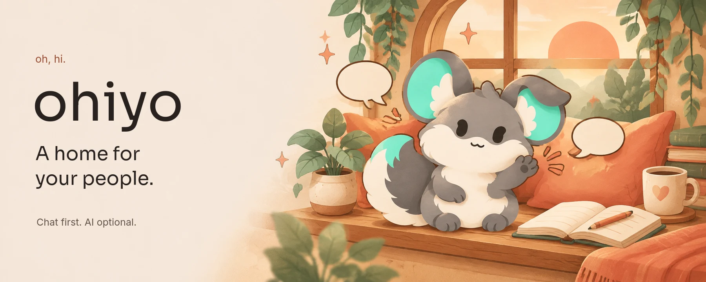
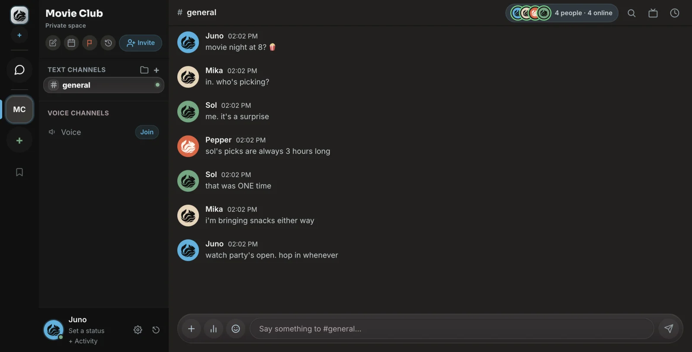
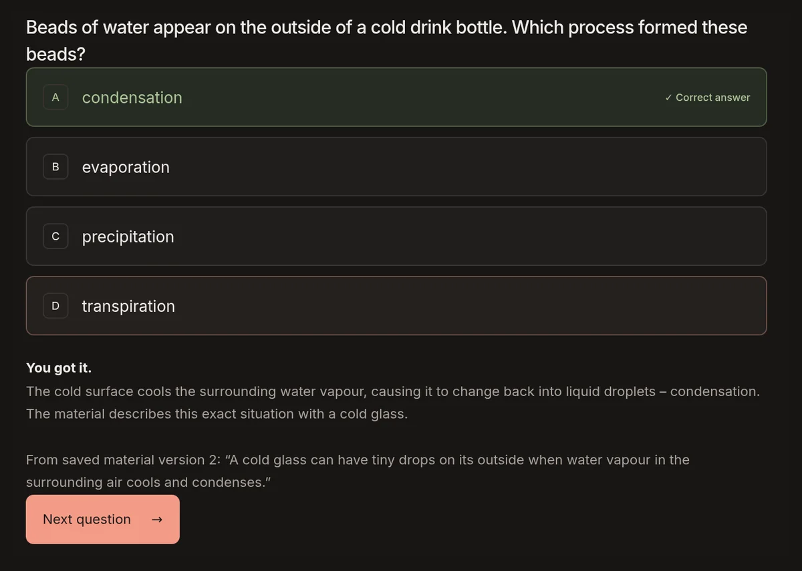

<p align="center">
  
</p>

<h1 align="center">Group chat that feels like home.</h1>

<p align="center">
  A place for your friends, family, and little corner of the internet.<br />
  Open source. Self-hostable. With a chinchilla who says hi.
</p>

<p align="center">
  <a href="https://app.ohiyo.gg"><strong>Open Ohiyo ↗</strong></a> ·
  <a href="https://ohiyo.gg">Visit the site</a> ·
  <a href="#quickstart-local-dev">Run it yourself</a> ·
  <a href="CONTRIBUTING.md">Contribute</a>
</p>

<p align="center">
  <a href="https://github.com/New1Direction/ohiyo/actions/workflows/ci.yml"></a>
  <a href="LICENSE"></a>
</p>

Ohiyo brings channels, DMs, voice, video, and screen sharing together without
making AI part of your conversations. Chat works without a model, an AI account,
or model credits. Want help making something? [Burrow](#meet-burrow-ai-only-when-you-ask)
is a separate, optional workspace.

**Web-first, still early.** [The browser app](https://app.ohiyo.gg) is the recommended
way in. Desktop builds are experimental; published Mac downloads are not notarized,
and Windows installers are currently disabled. This is not externally audited software.

## A place for your people



*Movie night, the family chat, or the project that started as “one quick idea.”*

- **Stay close.** Spaces, channels, threads, DMs, reactions, attachments, and DM
  delivery/read receipts keep the conversation together.
- **Drop into a room.** Voice, video, and screen sharing, with a pre-join roster
  and a join-muted option. See who's there before hopping in.
- **Make it yours.** Daybreak and Dusk themes, custom profiles, and reduced-motion
  support. Meet **Kikka**, the grey-and-mint chinchilla keeping your seat warm.
- **Choose encrypted conversations.** Turn on end-to-end encryption for DMs and
  group chats. It is **opt-in, not the default**; server channels are not E2EE.
  Group encryption is experimental. [Know the limits](#known-limits-of-the-encryption).
- **Bring your community.** [Discord template import](docs/discord-template-migration.md)
  rebuilds categories, channels, roles, and more. Channel webhooks let your own
  services post updates.
- **Host it yourself.** Rust, SQLite, and your own infrastructure. Optional TURN
  and LiveKit support help with stricter networks and larger calls.

> Instant Server provisioning and paid hosting are built but **not enabled on the
> hosted service**. Self-hosting is available; one-tap managed hosting is not.

## Meet Burrow. AI only when you ask.

[Burrow](https://app.ohiyo.gg/burrow) is Ohiyo's early-access space for making,
learning, and working through an idea with Kikka. It does **not** silently read
your Ohiyo conversations or turn chat into an AI feed.

**Make a presentation.** Work on saved material, attach source excerpts or school
notes, review accuracy and audience suitability, then download supported outlines
as PowerPoint. Human review and export do not require an AI second opinion.

**Learn from your material.** Explicitly allow one bounded generation from selected
saved text: an explanation, a worked example, and three practice questions. Review
the answers and supporting quotes before practising. Scores are temporary, not a
learner profile or proof of mastery.

**Make something interactive.** Create a quiz, branching story, checklist, or
visual explainer from trusted components. Ready-made examples are available
without a configured AI service.



*A real practice view using synthetic school material, not a generated UI mockup.*

**Your permission is the starting point.** Burrow discloses the destination and
possible cost before AI work. The Pi Durable runtime keeps task execution behind
explicit permissions; project boundaries and human review still apply. Nothing
silently installs or activates. The practice path is tool-free, with no automatic
retry or paid fallback.

**A different privacy boundary from encrypted chat:** Burrow's saved material,
drafts, and reviews are account-scoped server data, **not end-to-end encrypted**.
Approved inputs go to the displayed AI service, whose retention policy applies.
Review output yourself before school use or sharing. Importing PDF/PPTX files,
OCR, and spaced repetition are not part of the current practice flow.

See the [Burrow guide](docs/burrow.md) for supported workflows, consent boundaries,
runtime setup, and current limits.

## Privacy, in plain language

Ohiyo is privacy-minded, not anonymous. We would rather explain the boundaries
than hide them behind a lock icon.

- **Encrypted DMs are a choice you turn on.** Those messages are encrypted on
  your device; the server relays ciphertext. Server channels, polls, and
  watch-party links are not end-to-end encrypted.
- **Account safety is separate.** Authenticator-based two-factor sign-in and
  single-use account recovery codes are available. Save recovery codes before
  you need them; account recovery does not unlock encrypted chat backups.
- **Call participation is visible.** Joining reveals you to the room/channel
  audience, even when media is encrypted.
- **Plugins still require trust.** Third-party plugins run in a Web Worker with
  no DOM or token access and with network APIs removed. Desktop relies on that
  sandbox alone; do not treat it as a reason to install untrusted code.

[Privacy Policy](https://ohiyo.gg/privacy.html) ·
[Privacy Threat Model](https://ohiyo.gg/threat-model.html) ·
[Report a security issue](SECURITY.md)

### Known limits of the encryption

<details>
<summary><strong>Read this before relying on encrypted chat</strong></summary>

- **Opt-in.** A conversation is encrypted only after someone turns on the lock.
  New DMs start unencrypted.
- **A contact's new device gets your message before you're told.** Your client
  encrypts to a newly listed contact device at once, then announces it in chat.
  If you had verified the contact, the warning is prominent and verification
  drops until you compare safety numbers again. A malicious server or someone
  with the contact's stolen session could read the message that reveals the
  new device. Unlisted-device messages raise a notice too. Compare safety
  numbers out of band for conversations that matter. A device added to your
  own account is announced on your other devices, with a “Not me” action that
  removes it and signs out every session.
- **Group encryption is experimental.** It uses Ohiyo's own sender-key design,
  not Signal's, and can miss messages sent while a member was offline.
- **Not end-to-end encrypted:** server channels, polls, and watch-party links.
- **Signing out removes readable history from that device.** Encrypted messages
  can only be decrypted once, so the app keeps a readable local copy. Signing
  out of your last account there removes those copies after confirmation; they
  cannot be decrypted on that device again. Other devices are unaffected.
- **One account per browser profile.** Encryption keys are stored per profile,
  not per account. A second account in the same profile reuses the first
  account's keys and breaks its sessions. Use separate profiles.
- **No external audit yet.** One-to-one chat uses a community TypeScript port
  of the Signal Protocol. The group scheme, voice keys, backup, and desktop
  vault are our own constructions.

See the [roadmap](ROADMAP.md) for planned improvements.

</details>

## Quickstart (local dev)

You need **Rust stable**, **Node 22.19+**, and **[Bun 1.4+](https://bun.sh)**.
Chat development does not need AI credentials or a running Burrow worker.

```bash
git clone https://github.com/New1Direction/ohiyo.git
cd ohiyo
```

**1. Start the server** in one terminal:

```bash
cd server
cp .env.example .env
# Set JWT_SECRET in .env; generate one with: openssl rand -base64 48
cargo run
```

The server listens on port **3000** and applies SQLite migrations on startup.

**2. Start the client** in another terminal, from the repository root:

```bash
cd client
bun install --frozen-lockfile
bun run dev
```

Vite listens on port **1420** and uses the local server on port 3000 by default.
Open the Vite address printed in your terminal, register an account, and make a
space. For the optional worker and provider configuration, see [Burrow setup](docs/burrow.md).

<details>
<summary><strong>Checks and desktop builds</strong></summary>

From `client/`:

```bash
bun run lint
bun run typecheck
bun run test:unit
bun run build
KIKKA_ORIGIN=http://localhost:1420 bun run test:e2e
```

End-to-end tests require both the server and client to be running and use
disposable test accounts. Use a local development database, not production.

From `server/`:

```bash
cargo fmt --check
cargo clippy --all-targets --locked -- -D warnings
cargo test --locked
```

For a local desktop bundle, run `bun run tauri build` from `client/` after
installing the [Tauri platform prerequisites](https://v2.tauri.app/start/prerequisites/).
The packaged app uses `VITE_SERVER_URL` from `client/.env.production`; point it at
your intended backend. A local build is not a signed or notarized release.

See [CONTRIBUTING.md](CONTRIBUTING.md) for the full development workflow.

</details>

## Under the hood

| Part | Built with | Where |
| --- | --- | --- |
| API & realtime | Rust, axum, sqlx, SQLite, WebSocket gateway | [`server/`](server/) |
| Browser app | React 19, TypeScript, Tailwind CSS 4, Vite | [`client/`](client/) |
| Desktop shell | Tauri 2 | [`client/src-tauri/`](client/src-tauri/) |
| Optional agent worker | Node.js, Pi Durable | [`worker/`](worker/) |
| Calls | WebRTC, optional TURN and LiveKit | [`infra/`](infra/) |
| Quality gates | Client/server tests and browser E2E in GitHub Actions | [`e2e/`](e2e/), [workflows](.github/workflows/) |

The hosted API and web app run on Railway; the public site lives on GitHub Pages.
Self-hosting, persistent storage, secrets, and optional services are covered in
the [deployment guide](DEPLOY.md). Back up uploads and worker journals as well as
SQLite; database-only replication is not a complete recovery plan.

## Come build with us

Small, thoughtful contributions are welcome. Start with the
[contributing guide](CONTRIBUTING.md), look through the [roadmap](ROADMAP.md), or
[open an issue](https://github.com/New1Direction/ohiyo/issues) to talk through an idea.
Please report vulnerabilities through [SECURITY.md](SECURITY.md), not public issues.

Ohiyo is licensed under [AGPL-3.0](LICENSE). You can use, modify, and self-host it
under that license. Modified network services must offer their corresponding
source to users; see the license for the full terms and redistribution obligations.

<p align="center">
  <br />
  <strong>oh, hi. glad you're here.</strong><br />
  <a href="https://ohiyo.gg">ohiyo.gg</a> · <a href="https://app.ohiyo.gg">Open the app</a> · <a href="docs/burrow.md">Burrow guide</a>
</p>

[Builder fees on repo.ing](https://repo.ing/token/9RnMkXRLtkpMSWSCfgbUoGsYmJovAgEgJ7z8sHnwbaHk)
